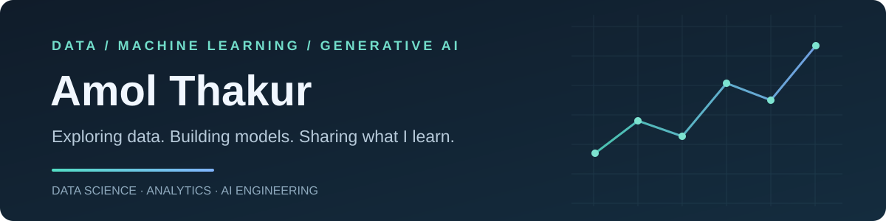
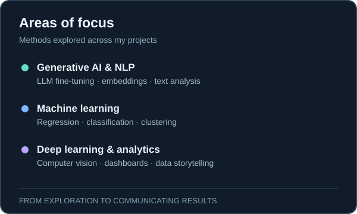
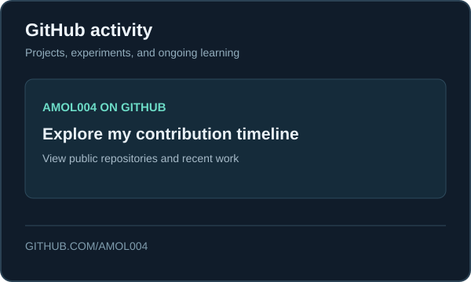

**Data science &nbsp;•&nbsp; Machine learning &nbsp;•&nbsp; Generative AI**

I enjoy exploring data, building models, and turning results into clear, useful stories.

### About

I'm Amol, a data science and AI practitioner with a civil engineering background. My work spans exploratory analysis, business dashboards, predictive models, computer vision, and adapting language models for customer support.

Currently exploring **LLM applications, document processing, and embeddings**, while building my skills across data science and analytics. I'm interested in Data Analyst, Data Scientist, and Generative AI opportunities.

  
  

### Selected work

<table>
  <tr>
    <td width="50%" valign="top">
      <strong>🤖 <a href="https://github.com/amol004/IndustryGPT-Specialised-LLM-Bot-Using-Pre-Trained-Models">IndustryGPT</a></strong> 
      Fine-tuned TinyLlama for retail support using 4-bit quantization and LoRA, with a Gradio chat interface.  
      Hugging Face · PyTorch · PEFT · QLoRA · Gradio
    </td>
    <td width="50%" valign="top">
      <strong>📚 <a href="https://github.com/amol004/Autonomous-Deep-Research-Multi-Agent-System">AI research assistant</a></strong> 
      Exploring conversational assistants, custom tools, document reading, chunking, and embeddings.  
      Python · LLM APIs · Ollama · MLX · embeddings
    </td>
  </tr>
  <tr>
    <td width="50%" valign="top">
      <strong>🛍️ <a href="https://github.com/amol004/Integrated-Retail-Analytics-for-Store-Optimization-Advanced-Machine-Learning">Retail analytics</a></strong> 
      Analyzed store sales, seasonal trends, anomalies, segmentation, and demand forecasting.  
      Python · pandas · time series · K-means
    </td>
    <td width="50%" valign="top">
      <strong>😊 <a href="https://github.com/amol004/DeepFER-Facial-Emotion-Recognition-Using-Deep-Learning">Facial emotion recognition</a></strong> 
      Built a convolutional neural network for seven-category facial expression classification.  
      TensorFlow · Keras · CNN · OpenCV
    </td>
  </tr>
  <tr>
    <td width="50%" valign="top">
      <strong>🚲 <a href="https://github.com/amol004/Seoul-Bike-Sharing-Demand-Prediction">Seoul bike demand</a></strong> 
      Compared regression models using time and weather features to estimate bicycle rental demand.  
      Regression · feature engineering · scikit-learn
    </td>
    <td width="50%" valign="top">
      <strong>🏦 <a href="https://github.com/amol004/FinInsight-Group-Data-Analysis-PowerBI">Banking dashboard</a></strong> 
      Built an interactive view of banking transactions, customer profiles, and financial trends.  
      Power BI · DAX · data modeling
    </td>
  </tr>
</table>

**More work:** [Netflix content clustering](https://github.com/amol004/NETFLIX-MOVIES-AND-TV-SHOWS-CLUSTERING) · [Mobile price classification](https://github.com/amol004/Flipkart-Mobile-Price-Range-Prediction) · [Supply chain dashboard](https://github.com/amol004/DataCo-Analysis-Group-Supply-Chain-Efficiency-Analysis-MS-Excel)

### Technical toolkit

| Area | Technologies and methods |
| --- | --- |
| **Languages & data** | Python · SQL · pandas · NumPy · Excel |
| **Machine learning** | scikit-learn · XGBoost · regression · classification · clustering · feature engineering |
| **Deep learning & vision** | TensorFlow · Keras · PyTorch · CNNs · OpenCV |
| **Generative AI & NLP** | Hugging Face Transformers · PEFT · LoRA / QLoRA · Ollama · embeddings · text processing |
| **Analytics & applications** | Power BI · DAX · Matplotlib · Seaborn · Plotly · Streamlit · Gradio |
| **Workflow** | Git · Docker · MLflow · Google Colab |

---

  Outside of data: wildlife photography · travel · fitness  
  <strong><a href="https://github.com/amol004?tab=repositories">Explore all repositories →</a></strong>

