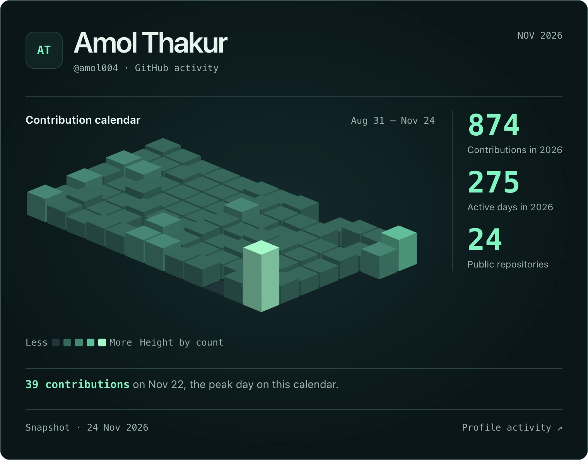
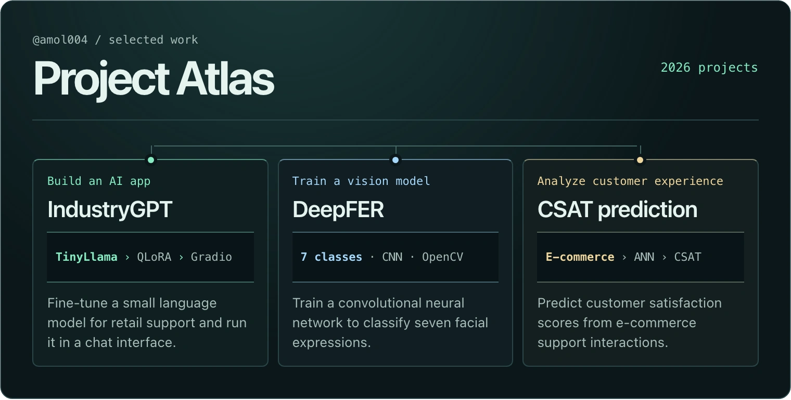

<a href="https://github.com/amol004?tab=overview&amp;from=2026-11-01&amp;to=2026-11-30">
<picture>
  <source media="(max-width: 550px)" srcset="assets/isometric-metrics-mobile.webp">
  
</picture>
</a>

**Data science · Machine learning · Generative AI**

I turn data into insights and build AI solutions that solve real-world problems

[Contribution activity](https://github.com/amol004?tab=overview&from=2026-11-01&to=2026-11-30) · [Technical skills](#technical-skills--toolkit)

### About

I'm Amol, a data science and AI practitioner. My work spans exploratory analysis, business dashboards, predictive models, computer vision, and adapting language models for customer support.

Currently exploring **LLM applications, document processing, and embeddings**, while building my skills across data science and analytics.

**Open to opportunities:** Data Analyst, Data Scientist, Machine Learning Engineer, Generative AI / AI Engineer, Python Developer, and Data Engineer roles.

<a name="selected-work"></a>

<picture>
  <source media="(max-width: 550px)" srcset="assets/project-atlas-2026-mobile.webp">
  
</picture>

**Open the notebooks** · [IndustryGPT](https://github.com/amol004/IndustryGPT-Specialised-LLM-Bot-Using-Pre-Trained-Models/blob/main/IndustryGPT_Specialized_LLM_Bot_Using_Pre_Trained_Models.ipynb) · [DeepFER](https://github.com/amol004/DeepFER-Facial-Emotion-Recognition-Using-Deep-Learning/blob/main/DeepFER_Facial_Emotion_Recognition_Using_Deep_Learning.ipynb) · [CSAT prediction](https://github.com/amol004/E-Commerce-Customer-Satisfaction-Score-Prediction-Deep-Learning/blob/main/E_Commerce_Customer_Satisfaction_Score_Prediction.ipynb)

<picture>
  <source media="(max-width: 550px)" srcset="assets/featured-workbench-2026-mobile.webp">
  
</picture>

After setup, run this from the repository root and press Enter to use the included sample PDF.

```bash
python embedding.py
```

[Setup instructions](https://github.com/amol004/Autonomous-Deep-Research-Multi-Agent-System#local-setup) · [Sample PDF](https://github.com/amol004/Autonomous-Deep-Research-Multi-Agent-System/blob/main/Day05%28Document_reading%29/Data/sample.pdf) · [Embedding script](https://github.com/amol004/Autonomous-Deep-Research-Multi-Agent-System/blob/main/embedding.py)

<a name="technical-skills--toolkit"></a>

<picture>
  <source media="(max-width: 550px)" srcset="assets/toolkit-map-mobile.webp">
  
</picture>

**See it in the repos** · [IndustryGPT](https://github.com/amol004/IndustryGPT-Specialised-LLM-Bot-Using-Pre-Trained-Models) · [DeepFER](https://github.com/amol004/DeepFER-Facial-Emotion-Recognition-Using-Deep-Learning) · [FinInsight](https://github.com/amol004/FinInsight-Group-Data-Analysis-PowerBI) · [Voyage Analytics](https://github.com/amol004/Voyage-Analytics-Integrating-MLOps-in-Travel)

<details>
<summary>Toolkit as text</summary>

- **Generative AI & NLP** — Hugging Face Transformers, PEFT / QLoRA, Ollama, Gemini API, LangChain, NLP, embeddings, ChromaDB.
- **Machine learning & deep learning** — Python, pandas, NumPy, scikit-learn, XGBoost, PyTorch, TensorFlow, Keras, OpenCV.
- **Analytics & visualization** — SQL, Excel, Power BI, DAX, Tableau, Matplotlib, Seaborn, Plotly.
- **Applications & development** — FastAPI, Gradio, Streamlit, Docker, MLflow, Git, Google Colab.

</details>

---

<div align="center">

  <strong><a href="https://github.com/amol004?tab=repositories">Explore all repositories →</a></strong>
</div>
