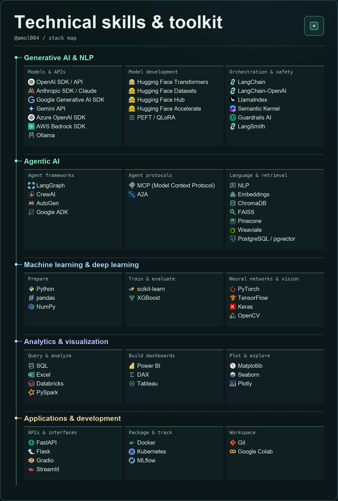

<a href="https://github.com/amol004?tab=overview&amp;from=2026-11-01&amp;to=2026-11-30">
<picture>
  <source media="(max-width: 550px)" srcset="assets/isometric-metrics-mobile.webp">
  
</picture>
</a>

**Data science · Machine learning · Generative AI**

I turn data into insights and build AI solutions that solve real-world problems

[Contribution activity](https://github.com/amol004?tab=overview&from=2026-11-01&to=2026-11-30) · [Technical skills](#technical-skills--toolkit)

### About

I'm Amol, a data science and AI practitioner. My work spans exploratory analysis, business dashboards, predictive models, computer vision, and adapting language models for customer support.

Currently exploring **LLM applications, document processing, and embeddings**, while building my skills across data science and analytics.

**Open to opportunities:** Data Analyst, Data Scientist, Machine Learning Engineer, Generative AI / AI Engineer, Python Developer, and Data Engineer roles.

### Selected work

<table>
  <tr>
    <td width="50%" valign="top">
      <strong>🤖 <a href="https://github.com/amol004/IndustryGPT-Specialised-LLM-Bot-Using-Pre-Trained-Models">IndustryGPT</a></strong> 
      Fine-tuned TinyLlama for retail support using 4-bit quantization and LoRA, with a Gradio chat interface.  
      Hugging Face · PyTorch · PEFT · QLoRA · Gradio
         
      Run the notebook with a GPU to launch the Gradio chat.
    </td>
    <td width="50%" valign="top">
      <strong>📚 <a href="https://github.com/amol004/Autonomous-Deep-Research-Multi-Agent-System">AI research assistant</a></strong> 
      Exploring conversational assistants, custom tools, document reading, chunking, and embeddings.  
      Python · LLM APIs · Ollama · MLX · embeddings
    </td>
  </tr>
  <tr>
    <td width="50%" valign="top">
      <strong>🛍️ <a href="https://github.com/amol004/Integrated-Retail-Analytics-for-Store-Optimization-Advanced-Machine-Learning">Retail analytics</a></strong> 
      Analyzed store sales, seasonal trends, anomalies, segmentation, and demand forecasting.  
      Python · pandas · time series · K-means
    </td>
    <td width="50%" valign="top">
      <strong>😊 <a href="https://github.com/amol004/DeepFER-Facial-Emotion-Recognition-Using-Deep-Learning">Facial emotion recognition</a></strong> 
      Built a convolutional neural network for seven-category facial expression classification.  
      TensorFlow · Keras · CNN · OpenCV
    </td>
  </tr>
  <tr>
    <td width="50%" valign="top">
      <strong>🚲 <a href="https://github.com/amol004/Seoul-Bike-Sharing-Demand-Prediction">Seoul bike demand</a></strong> 
      Compared regression models using time and weather features to estimate bicycle rental demand.  
      Regression · feature engineering · scikit-learn
    </td>
    <td width="50%" valign="top">
      <strong>🏦 <a href="https://github.com/amol004/FinInsight-Group-Data-Analysis-PowerBI">Banking dashboard</a></strong> 
      Built an interactive view of banking transactions, customer profiles, and financial trends.  
      Power BI · DAX · data modeling
    </td>
  </tr>
</table>

**More work:** [Netflix content clustering](https://github.com/amol004/NETFLIX-MOVIES-AND-TV-SHOWS-CLUSTERING) · [Mobile price classification](https://github.com/amol004/Flipkart-Mobile-Price-Range-Prediction) · [Supply chain dashboard](https://github.com/amol004/DataCo-Analysis-Group-Supply-Chain-Efficiency-Analysis-MS-Excel)

<picture>
  <source media="(max-width: 550px)" srcset="assets/toolkit-map-mobile.webp">
  
</picture>

**See it in the repos** · [IndustryGPT](https://github.com/amol004/IndustryGPT-Specialised-LLM-Bot-Using-Pre-Trained-Models) · [DeepFER](https://github.com/amol004/DeepFER-Facial-Emotion-Recognition-Using-Deep-Learning) · [FinInsight](https://github.com/amol004/FinInsight-Group-Data-Analysis-PowerBI) · [Voyage Analytics](https://github.com/amol004/Voyage-Analytics-Integrating-MLOps-in-Travel)

Toolkit as text

- **Models, APIs & fine-tuning** — Hugging Face Transformers, Datasets, Hub and Accelerate; PEFT / QLoRA; Ollama; Google Generative AI SDK / Gemini API; OpenAI SDK / API; Anthropic SDK / Claude; Azure OpenAI SDK; AWS Bedrock SDK.
- **Agents & orchestration** — LangChain, LangChain-OpenAI, LangGraph, CrewAI, AutoGen, LlamaIndex, Semantic Kernel, Google ADK, MCP, A2A, LangSmith, Guardrails AI.
- **Retrieval & databases** — NLP, embeddings, ChromaDB, FAISS, Pinecone, Weaviate, PostgreSQL / pgvector.
- **Machine learning & deep learning** — Python, pandas, NumPy, scikit-learn, XGBoost, PyTorch, TensorFlow, Keras, OpenCV.
- **Analytics & visualization** — SQL, Excel, Power BI, DAX, Tableau, Matplotlib, Seaborn, Plotly, Databricks, PySpark.
- **Applications & development** — FastAPI, Flask, Gradio, Streamlit, Docker, Kubernetes, MLflow, Git, Google Colab.

---

  <strong><a href="https://github.com/amol004?tab=repositories">Explore all repositories →</a></strong>

